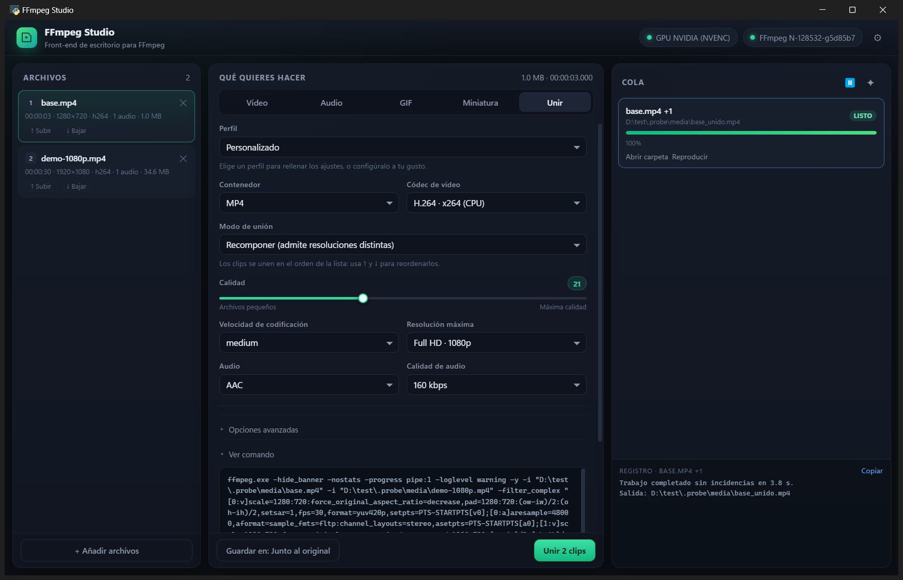
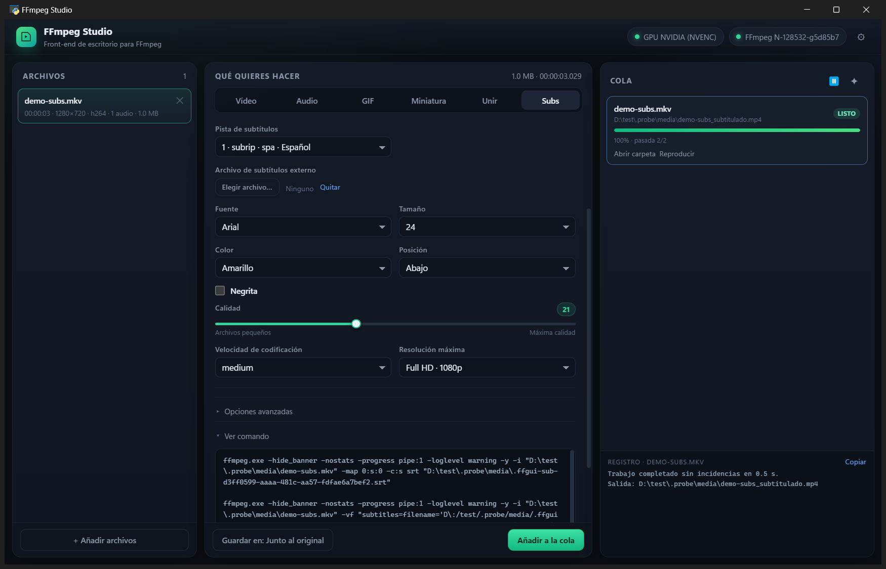

# FFmpeg Studio

Aplicación de escritorio para Windows que pone una interfaz clara delante de **FFmpeg**:
arrastras (o eliges) tus archivos, decides qué quieres conseguir y la app construye, valida
y ejecuta el comando por ti, con cola de trabajos y progreso.

No hay que escribir comandos, pero el comando siempre está a la vista y se puede copiar.



---

## Qué se puede hacer

| Tarea | Qué hace | Detalle técnico |
|---|---|---|
| **Vídeo** | Convertir, comprimir, cambiar contenedor, recortar, escalar | `-c:v`/`-c:a`, CRF o bitrate, `scale`, `-ss`/`-t`, `-movflags +faststart` |
| **Audio** | Extraer o convertir la pista de sonido a MP3, M4A, WAV, FLAC, Opus | `-vn`, códec y bitrate |
| **GIF** | GIF animado con paleta optimizada (dos etapas en un solo filtro) | `palettegen` + `paletteuse` |
| **Miniatura** | Un fotograma como JPG/PNG/WebP | `-frames:v 1 -update 1` |
| **Hoja** | Rejilla de fotogramas del vídeo (2×2, 3×3, 4×3…) | `fps` + `tile` |
| **Grabar** | Captura de pantalla, una ventana o webcam | `gdigrab` / `dshow` |
| **Unir** | Une varios clips en un solo archivo, en el orden que elijas | demuxer `concat` (copia) o filtro `concat` (recodifica) |
| **Subs** | Extrae, incrusta o quema subtítulos, con pista, idioma y estilo | `-map 0:s`, `-c:s mov_text`, filtro `subtitles` + `force_style` |
| **Cola** | Varios archivos de una vez, progreso, velocidad, ETA, cancelar | `-progress pipe:1` + `q` por stdin |
| **Presets** | 15 perfiles listos (web, móvil, archivo HEVC, AV1, NVENC, ProRes…) | `presets.json` |

Extras que ya incluye:

- **Inspector** de cada archivo (duración, resolución, códecs, pistas, tamaño).
- **Detección real de GPU**: no se fía de que el códec exista; hace una codificación de prueba.
- **Velocidad y fps**: acelerar o ralentizar conservando el tono (`atempo` encadenado) y fijar la
  cadencia de salida.
- **Encuadre**: recortar bordes en píxeles, rotar 90/180/270° y voltear en horizontal o vertical.
- **Selección de pistas**: elegir la pista de audio (o todas) y qué subtítulos conservar, con su
  idioma y conversión a `mov_text` cuando el contenedor lo exige.
- **Vista previa del comando** antes de ejecutar, con validación de combinaciones imposibles
  (por ejemplo AV1 dentro de AVI, o escalar sin recodificar).
- **Dos pasadas** con bitrate objetivo, manteniendo las mismas pistas en ambas pasadas.
- **Recorte** en modo exacto o rápido, avisando de la diferencia.
- **Unión de clips** con dos estrategias: copia directa (sin pérdida) o recomposición sobre un lienzo
  común, con reordenación por flechas y silencio automático si algún clip no tiene audio.
- **Subtítulos**: extraer pistas incrustadas, incrustar un archivo externo con idioma y pista
  predeterminada, o quemarlos en la imagen con fuente, tamaño, color y posición.
- **Escritura atómica**: cada trabajo se escribe en un temporal y se renombra al terminar, así que
  cancelar o fallar nunca deja un archivo a medias.
- **Control de espacio** antes de empezar (y otra vez al arrancar el trabajo), con **estimación
  visible** de tamaño y duración antes de encolar.
- **Reintento automático GPU→CPU** si el codificador de hardware falla a mitad de trabajo.
- **Instancia única**: abrir la app de nuevo enfoca la ventana que ya existe.
- **Cola persistente**: los trabajos pendientes y el historial reciente se recuperan al abrir la app.
- **Normalización EBU R128** con objetivo −14 (streaming), −16 (podcast) o −23 LUFS (difusión).
- **Grabación**: pantalla completa, una ventana por título o webcam, con duración fija o hasta que
  pulses cancelar. Guarda en la carpeta de salida, `Videos` o, si no hay permisos, en una temporal.
- **Editor de subtítulos** (SRT y VTT): tabla de cues con tiempos y textos editables, añadir o
  quitar, validación de solapes y «Guardar» / «Guardar como…». Los ASS se extraen primero a SRT.
- **Modo CLI** (`--cli`) para convertir sin abrir la interfaz.
- **Elección de carpeta de salida** y nombres únicos (nunca sobrescribe).
- **Registro** por trabajo con los mensajes de FFmpeg y errores traducidos a lenguaje humano.

---

## Requisitos

- Windows 10/11 con **WebView2** (viene preinstalado en Windows 11; en Windows 10 se instala solo
  con Edge actualizado).
- **Python 3.10 o superior** (solo si ejecutas el código; con el `.exe` no hace falta).
- Una build de **FFmpeg** con `ffmpeg.exe` y `ffprobe.exe` (probado con `N-128532`, GPLv3).

```bat
pip install -r requirements.txt
```

La app busca FFmpeg en este orden: ajuste guardado → `..\ffmpeg-master-latest-win64-gpl\bin\`
→ `.\ffmpeg\bin\` → `PATH`. También puedes elegirlo desde **⚙ Ajustes**.

---

## Cómo se ejecuta

Doble clic en **`FFmpeg Studio.bat`** (abre sin consola), o:

```bat
python app.py
python app.py "D:\videos\clip.mp4"
```

Puedes arrastrar archivos sobre el `.bat`: se abren directamente en la app.

### Versión empaquetada

La carpeta **`dist\FFmpegStudio\`** contiene la aplicación ya compilada:

```bat
dist\FFmpegStudio\FFmpegStudio.exe "D:\videos\clip.mp4"
```

Es portable: se puede copiar a otro equipo con Windows 10/11 y funciona sin instalar Python.
Incluye `ffmpeg\bin\` con los ejecutables si estaban disponibles al compilar; si no, la app los
busca en el `PATH` o permite elegirlos en ⚙ Ajustes.

### Línea de comandos (opcional)

La misma aplicación puede convertir sin abrir la ventana:

```bat
FFmpegStudio.exe --cli "entrada.mkv" "salida.mp4"
FFmpegStudio.exe --cli entrada.mp4 salida.mp4 --crf 24 --width 1280
FFmpegStudio.exe --cli entrada.mkv salida.mp4 --preset mp4-h264-web
FFmpegStudio.exe --cli entrada.mp4 salida.mp4 --log progreso.txt
```

- Usa el mismo motor, validaciones y escritura atómica que la interfaz.
- Códigos de salida: `0` correcto, `1` fallo de FFmpeg, `2` parámetros o archivo inválidos.
- En la versión sin consola (`--windowed`), añade `--log` para guardar el progreso; sin él la
  salida se descarta.

### Uso en tres pasos

1. **Añade archivos** (botón o arrastrando sobre la ventana).
2. Elige la pestaña (**Vídeo / Audio / GIF / Miniatura**), un perfil si quieres, y ajusta.
3. **Añadir a la cola**. Se procesan de uno en uno; puedes pausar, cancelar o abrir la carpeta.

### Unir clips

La pestaña **Unir** trabaja sobre **toda la lista de archivos**, en el orden en que aparecen
(usa ↑ / ↓ para moverlos). Hay dos modos y la app elige el error antes que tú:

| Modo | Cuándo usarlo | Qué hace por dentro |
|---|---|---|
| **Copia directa** | Los clips comparten códec, resolución y audio (por ejemplo, trozos de la misma cámara) | Demuxer `concat` + `-c copy`: instantáneo, sin recodificar |
| **Recomponer** | Resoluciones, fps o códecs distintos | Normaliza cada clip (escala con letterbox, fps, 48 kHz estéreo) y usa el filtro `concat` |

En modo **Recomponer** puedes añadir un **fundido encadenado** entre clips (`xfade` para vídeo y
`acrossfade` para audio) con duración de 0,5 a 2 s. El fundido acorta el total y la vista previa lo
refleja. En copia directa no está disponible: la app cambia sola a Recomponer al elegirlo.

Si eliges copia directa con clips incompatibles, la vista previa lo dice y sugiere **Recomponer**.
Si algún clip no tiene audio, en modo Recomponer se añade silencio en ese tramo (en copia directa
no es posible y también se avisa).

### Subtítulos



La pestaña **Subs** trabaja sobre el archivo seleccionado y tiene tres acciones:

| Acción | Para qué | Detalle |
|---|---|---|
| **Extraer** | Sacar una pista incrustada a `.srt`, `.ass`, `.vtt` o `.sup` | Sin recodificar el vídeo |
| **Incrustar** | Añadir un archivo externo al vídeo, con idioma y pista predeterminada | Copia vídeo y audio; MP4 convierte a `mov_text` |
| **Quemar** | Fijar los subtítulos en la imagen (no se pueden quitar) | Recodifica el vídeo; fuente, tamaño, color y posición |

Notas útiles:

- Los subtítulos de **imagen** (PGS/DVD) no se pueden convertir a texto: se extraen como `.sup`.
- Incrustar **ASS en MP4** pierde estilos; si los necesitas, usa MKV.
- Al quemar una pista incrustada, la app la extrae primero a un archivo temporal y lo borra al terminar.
- El idioma y el título se escriben en los metadatos de la pista, y puedes marcarla como predeterminada.

### Cuando algo va mal

| Situación | Comportamiento |
|---|---|
| Cancelas un trabajo | Se borra el archivo temporal; no queda nada a medias |
| Un trabajo falla | Igual: se limpia el temporal y se muestra el error traducido |
| Poco espacio en disco | Se avisa antes de encolar y se vuelve a comprobar al arrancar |
| La GPU falla (driver, memoria) | Se reintenta una vez en CPU con el códec equivalente; la cola muestra `CPU` |

La salida se escribe en `.<uuid>.ext` dentro de la carpeta de destino (misma unidad, renombrado
instantáneo) y solo aparece con su nombre final cuando el trabajo termina bien.

---

## Arquitectura

```
app.py                 Puente con la interfaz (clase Api) y arranque de la ventana
core/
  command.py           Catálogo de contenedores/códecs, comandos (incluida la unión) y validación
  probe.py             Lectura de metadatos con ffprobe (JSON normalizado)
  runner.py            Proceso FFmpeg, progreso, cancelación limpia, dos pasadas
  queue.py             Cola secuencial segura entre hilos
  ffmpeg.py            Localización de FFmpeg y detección de hardware
  presets.py           Carga de presets.json
  settings.py          Ajustes en %APPDATA%\FFmpegStudio\settings.json
  errors.py            Traducción de errores de FFmpeg
  options.py           Opciones por defecto
web/                   Interfaz (HTML + CSS + JS, sin frameworks)
presets.json           Catálogo de perfiles editable
tests/                 22 pruebas: unidades, integración real y cola completa
```

Decisiones que conviene conocer:

- **Sin `cmd.exe`**: FFmpeg se lanza con una lista de argumentos, no con una cadena. Las rutas con
  espacios o acentos no necesitan comillas manuales.
- **Escala calculada en Python**: en lugar de `scale=min(...)`, se calculan las dimensiones exactas
  a partir de los metadatos. Evita el infierno de escapes de los filtros.
- **Nunca sobrescribe**: genera `nombre (2).mp4` si el destino existe.
- **Archivos de dos pasadas** junto a la salida y se borran al terminar.

---

## Empaquetado (.exe)

```bat
pip install -r requirements-dev.txt
build.bat            :: versión sin consola
build.bat console    :: con consola, para diagnosticar
```

Genera `dist\FFmpegStudio\` con `FFmpegStudio.exe`, `FFmpegStudio.exe.config`, la interfaz web,
los presets, el icono y (si existe junto al proyecto) `ffmpeg\bin\`.

> **Importante:** ejecuta siempre `dist\FFmpegStudio\FFmpegStudio.exe`. PyInstaller crea durante la
> compilación un `build\FFmpegStudio\FFmpegStudio.exe` intermedio que **no** funciona: no tiene las
> DLL a su lado y falla con `Failed to load Python DLL`. El script borra esa carpeta al terminar.

Detalles que importan:

- **`FFmpegStudio.exe.config`** habilita `loadFromRemoteSources`. Sin él, .NET se niega a cargar
  `Python.Runtime.dll` cuando la carpeta está en una unidad de red (o en `D:` en este equipo) y la
  app muere con `Failed to resolve Python.Runtime.Loader.Initialize`. Por eso el `.config` debe
  viajar siempre junto al `.exe`.
- **`tools/pyi_rth_pythonnet.py`** es el *runtime hook* que expone `pythonXY.dll` y las DLL de
  WebView2 a pythonnet antes de importar la interfaz.
- **Tamaño**: la aplicación son ~20 MB; con FFmpeg dentro, ~345 MB (la build estática GPL pesa
  ~325 MB). Para una entrega ligera, compila sin FFmpeg a su lado y deja que el usuario lo elija.
- Windows puede mostrar un aviso de SmartScreen al no estar firmado el ejecutable.
- La compilación tarda 1–2 minutos y necesita ~1 GB libre temporalmente.

### Variables de entorno del script

- `FFMPEG_DIR`: carpeta que contiene `ffmpeg.exe`/`ffprobe.exe` (o su `bin`). Por defecto usa
  `..\ffmpeg-master-latest-win64-gpl\bin`. Sirve para CI o para otra instalación de FFmpeg.
- `FFGUI_DISTPATH`: carpeta de salida de PyInstaller. Útil si `dist\` está bloqueada por otro proceso.

## Instalador

```bat
pip install -r requirements-dev.txt
build.bat
installer\build-installer.ps1
```

Genera `installer\Output\FFmpegStudio-Setup-1.0.1.exe` (~100 MB comprimido, 979 archivos dentro).
Necesita **NSIS 3** (`makensis.exe`); si no está en `Program Files`, pasa `-Nsis <ruta>`. También
puedes usar Inno Setup con `installer\build-installer.ps1 -Inno -Iscc <ruta>`.

Qué hace el instalador:

- Instala **por usuario** en `%LOCALAPPDATA%\Programs\FFmpeg Studio` (sin administrador).
- Copia la aplicación completa con FFmpeg y crea accesos en el menú Inicio; el de escritorio es
  opcional.
- Registra la entrada de «Aplicaciones y características» con su desinstalador.
- Muestra el aviso de licencia de FFmpeg (GPLv3) antes de instalar y permite abrir la app al final.
- Los ajustes y la cola (`%APPDATA%\FFmpegStudio`) se conservan al desinstalar.

> El instalador se compila y su contenido está verificado (7-Zip lista los 979 archivos), pero en
> este equipo de desarrollo no se puede ejecutar ningún instalador: el entorno bloquea los procesos
> de *setup*. En un Windows normal funciona; el CI lo compila en cada cambio.

## Integración continua (GitHub Actions)

`.github/workflows/build.yml` se ejecuta en `windows-latest` con cada `push`, cada *pull request* y
a mano (`workflow_dispatch`):

1. Python 3.10 + dependencias.
2. Descarga FFmpeg essentials y define `FFMPEG_DIR`.
3. Genera `..\.probe\media\base.mp4` para que las pruebas de integración no se omitan.
4. `node --check web/app.js`.
5. Las 138 pruebas.
6. `build.bat`.
7. Instala NSIS con Chocolatey y compila el instalador.
8. Publica dos *artifacts*: el portable y el instalador.

El repositorio debe tener la carpeta del proyecto como raíz (donde está `app.py`). Para activarlo:

```bat
git init
git add .
git commit -m "FFmpeg Studio"
git remote add origin https://github.com/USUARIO/REPO.git
git push -u origin main
```

Los binarios (`dist/`, `installer/Output/`) no se suben: están en `.gitignore` y el CI los genera.

### Ejecutar el CI en local

```bat
powershell -ExecutionPolicy Bypass -File tools\run-ci.ps1
```

Replica los pasos del workflow: dependencias, FFmpeg, muestra de pruebas, `node --check`, las 138
pruebas, `build.bat` y el instalador. Opciones útiles:

- `-Version 1.1.0`: versión del instalador.
- `-SkipInstaller`: solo portable (más rápido).
- `-DistPath dist-ci`: otra carpeta de salida si `dist\` está bloqueada.
- `-ForceFixture`: regenera el vídeo y el SRT de muestra.
- `-FfmpegDir <ruta>`: usa otro FFmpeg.

`act` no sirve para este workflow: solo ejecuta runners Linux y aquí se usa `windows-latest`. Para
ejecutar el workflow real en tu equipo habría que registrar un **self-hosted runner** y añadir
`self-hosted` a `runs-on`; en repositorios públicos eso permite que código de terceros se ejecute en
tu máquina, así que no es recomendable.

## Pruebas

```bat
python -m unittest discover -s tests -v
```

- `test_command.py`: construcción de argumentos y validaciones.
- `test_concat.py`: unión por copia y por filtro, silencio de relleno y validaciones.
- `test_subs.py`: extraer/incrustar/quemar, estilos y validaciones de subtítulos.
- `test_effects.py`: velocidad, fps, encuadre y hoja de contactos.
- `test_tracks.py`: selección de pistas de audio/subtítulos y fundidos al unir.
- `test_capture.py`: comandos y validación de captura, más una grabación real de 2 s.
- `test_editor.py`: lectura, edición y guardado de subtítulos (SRT/VTT).
- `test_persistence.py`: guardado y restauración de la cola.
- `test_robustness.py`: espacio en disco, escritura atómica y reintento GPU→CPU.
- `test_cli.py`: modo `--cli`, códigos de salida y estimación expuesta.
- `test_integration.py`: ejecuta FFmpeg de verdad (recorte, GIF, miniatura, dos pasadas, unión).
- `test_api.py`: flujo completo del puente (preview → cola → salida verificada con ffprobe).

Son 138 pruebas. Las de integración usan `..\.probe\media\base.mp4`; si no existe, se omiten.

---

## Presets

`presets.json` es el catálogo que alimenta el desplegable **Perfil**. Cada entrada es semántica
(no es una línea de comandos): contenedor, códec, CRF, resolución máxima, audio y notas.
Para añadir uno nuevo basta con copiar un bloque y cambiar los valores; aparece al reiniciar.

---

## Limitaciones conocidas

- **Subtítulos**: se extraen, incrustan y queman; no se editan textos ni tiempos dentro de la app
  (edita el `.srt` con tu herramienta favorita y luego incrústalo o quémalo).
- **Arrastrar y soltar** dentro de la ventana no está disponible con WebView2; usa el botón o
  arrastra sobre el `.bat`.
- No hay empaquetado `.exe` incluido; se ejecuta con Python. (Empaquetable con PyInstaller.)
- El GIF se genera en una sola pasada de filtros: buena calidad, pero sin control fino de *dithering*.
- La unión por copia directa no admite clips con parámetros distintos ni puede inventar audio;
  para esos casos está el modo Recomponer.

